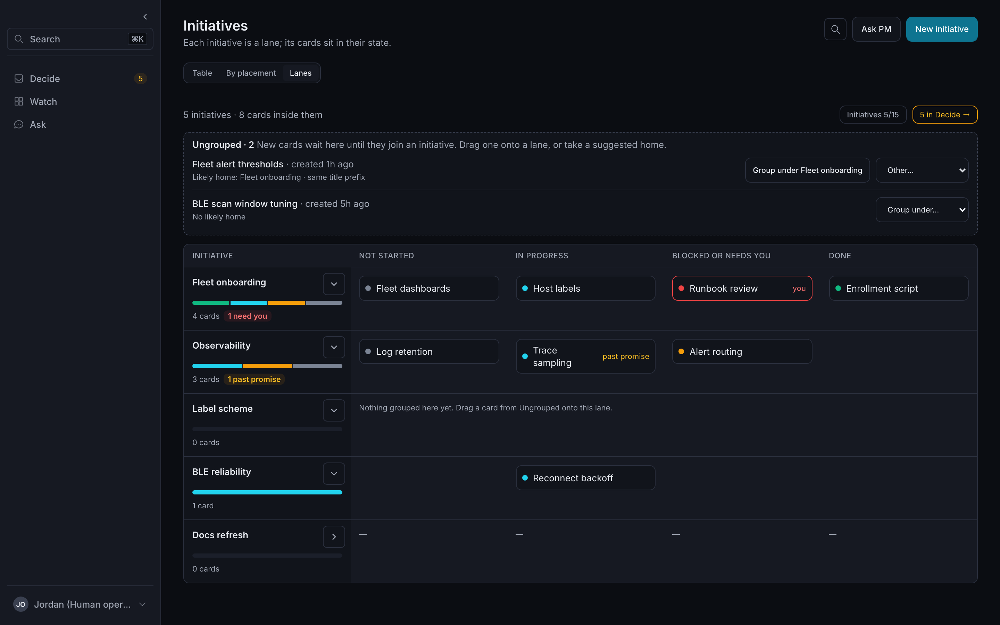
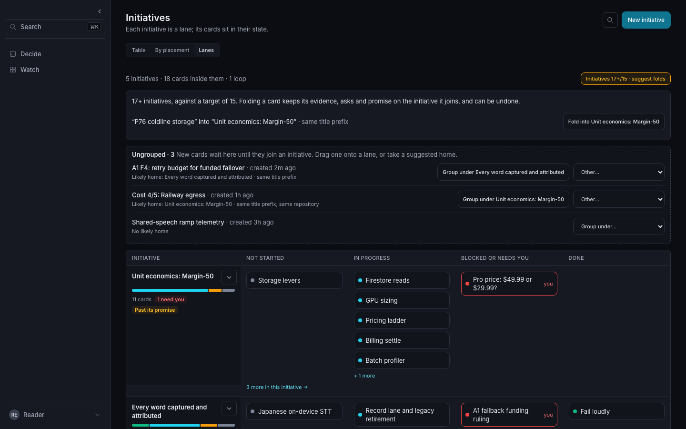
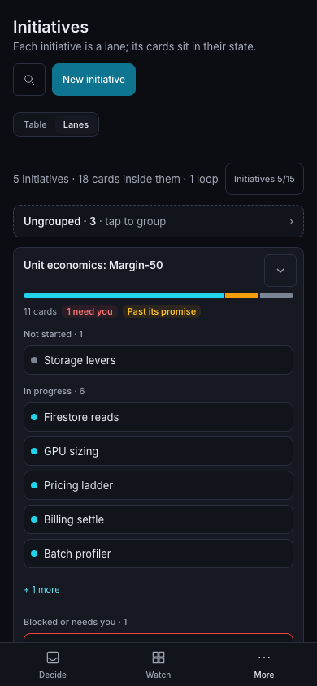
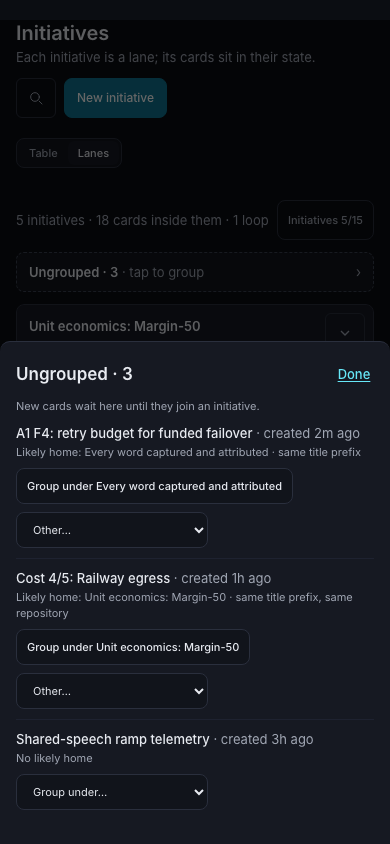

# Group work by default

Grouping a new card stays optional and non-blocking. Core supplies deterministic
suggestions; it never runs a model or chooses a parent for the caller. The same
behavior is available through HTTP, CLI and the generated MCP catalog.

Create a card and its parent plan step in one transaction:

```sh
anx work create --from-file task.json --under card:initiative --after investigate
anx cards create --board board:tasks --title "Measure" --body "Compare results" --under card:initiative
anx work group card:measure --under card:initiative
```

`after` is an existing **plan step ID**, expressing a dependency. Grouping twice
does not add another step. Cycles, a terminal parent, and invalid dependencies
are rejected atomically. A request with `under` must succeed in both creating
the card and linking the step, or do neither. Creating without `under` never
requires a grouping decision or an over-budget reason.
When `board_ref` is omitted with `under`, the new card inherits its parent's
board, including its visibility. An explicit board still permits cross-board work.

HTTP writes accept `request_key`. Exact retries return the original response;
reusing a key for another body conflicts. CLI grouping commands allocate a key
when omitted and include it in an uncertain-outcome error. MCP exposes
`idempotency_key`, mapped to the same receipt. Keep the original key and body.

## Hierarchy and brief

A card is a child when an ordinary `card:` plan step of a **visible open parent**
references it. Multiple parents choose the oldest parent card by `created_at`,
then storage ID. This rule uses existing creation times, not inferred link ages.
The chosen parent receives the child count; duplicate steps do not double-count.
Closing, archiving or trashing a parent releases its children to top level.

The chosen parent's owner is also the first fallback for an ended agent work
lease, before the workspace lead. Responsibility transfers with an automatic
note and enters the daily digest; it does not create another execution lease.
See [tracking defaults](tracking-defaults.md).
The parent board must also be active. `related_refs` alone never creates hierarchy.

Work/card reads and brief items expose `parent_ref` (null for top level) and:

```json
{
  "rollup": {
    "total": 1,
    "by_state": { "in_progress": 1 },
    "past_promise": 1,
    "needing_viewer": 1,
    "children": [
      {
        "ref": "card:measure",
        "title": "Measure",
        "step_id": "measure",
        "state": "in_progress",
        "past_promise": true,
        "needs_viewer": true
      }
    ],
    "workstreams": [],
    "has_more": false
  }
}
```

`by_state` uses canonical work phases. `needing_viewer` counts children with an
open decision addressed to the viewer, once per child. `workstreams` are child
plan steps which themselves link card children. Counts and previews are scoped
before aggregation; hidden children do not affect `has_more`. Valid plans have
at most 200 steps. Authored plan privacy still applies to the whole plan.

`GET /brief` keeps top-level non-loop work in `initiatives`, puts loop-bound
cards in `loops`, and adds `initiative_budget: {count, target: 15, truncated}`
and at most ten suggested fold `next_actions`. `orient` prints `initiatives N/15`
(or `N+/15` for a lower bound). No write is blocked. The budget samples the most
recent 200 physical open-card identities across boards, then applies visibility
and excludes children and loops. It is at least the number of visible live roots
in the displayed brief. Principal-scoped budgets always mark `truncated`, so
the marker cannot disclose hidden window occupancy; their count is a lower bound.
Brief promise/evidence categories admit 200 physical identities before scoped
hydration and hierarchy filtering, then display at most 50. No selector scans
past hidden positions to fill its preview. The paged `/work` API remains the full inventory.

## Likely home and the Ungrouped tray

Both `POST /work` and `POST /cards` return `likely_home` on the created item and
response, plus a runnable `next_actions` grouping command when a match exists.
`ask` auto-created subjects use `POST /work`, carry `ask.auto_create` attribution,
and retain these hints in the composed ask result. MCP creates carry `mcp`
attribution. The registration audit event records `create_surface`; this is
client attribution, not an authenticated provenance claim.

Candidates are visible open top-level non-loop cards. Reasons and scores are:

| Reason                                     | Score |
| ------------------------------------------ | ----: |
| Parent named in `related_refs`             |  1000 |
| Shared related/source URL or typed ref     |   100 |
| Same repository URL or explicit repository |    30 |
| Same `project_ref`                         |    20 |
| Same title prefix family                   |    10 |

Scores add; ties use oldest creation time, then ID. One implementation recognizes
`P76`, `A1`, `fs-p3`, and numbered families such as `Cost 2/5`. Matching does not
fetch URLs. Related-parent candidates are admitted by identity even outside the
recent cohort. At most three suggestions are returned; an empty list is valid.

`GET /work/ungrouped?limit=20` (`anx work ungrouped`) returns compact
`{work: [{ref, title, phase, parent_ref, created_at, likely_home, next_actions}], has_more}`.
The tray includes completed, unarchived cards; suggested homes remain open.
The maximum page is 50 within the recent cohort; `has_more` describes additional
visible eligible rows in that cohort. Hidden rows never set it. This endpoint is
a recent tray, not an exhaustive cursor feed.

Fold suggestions use the same matching function, point toward older candidates,
and add `stale_top_level` after seven days without a card update. A stale card
without a match may suggest the oldest visible candidate; the caller must choose.

## Fold and unfold

```sh
anx work fold card:measure --into card:initiative --request-key fold-measure-1
anx work unfold card:measure --request-key unfold-measure-1
anx cards archive card:measure --reason "superseded by the initiative"
```

Fold records `relations: [{kind: "merged_into", ref: "card:initiative"}]` on the
child, transfers its authored related refs, resolution evidence refs and
structured `source_refs` to the parent, and carries its counted promise as the
parent step's `due`. The child is archived with reason `folded into card:initiative`.
Discussion, observations and asks remain append-only on the child, reachable
through the parent's plan step and related child ref. Open asks retain their
original subject and answer target. Conflicting source identities reject the
whole fold; no evidence is overwritten.
The new relation retains the existing 200-entry relation limit; exceeding it
rejects the entire fold without archiving or plan edits.

Unfold restores the transferred fields, prior plan and child lifecycle from a
scoped snapshot. It preserves unrelated metadata edits and rejects conflicting
changes in transferred fields or the parent plan with 409. It never overwrites
new user work. Fold/unfold audit events and original replay receipts remain.

Ordinary author messages, plan-step additions/removals and next-action edits
preserve promises. A newer explicit `next` replaces that author's promise;
actual evidence and step status changes can still meet it. Plan edits cannot fulfill their own milestones. Plain messages do not
consume the bounded promise-fact window.

## Inherited run parent

Label agentctl runs `anx.card.<initiative>` and cards land under it. When
`AGENTCTL_EXECUTION_ID` is set, the CLI reads the execution's labels through
`agentctl status <id> --output json` (the documented JSON output flag).
`work create`, `cards create`, `boards cards create-batch`, generic API card creates, and auto-created
`ask`/`review`/`escalate` subject cards use that parent. An MCP server inheriting
the run environment applies the same default to work/card creates, including board batches.
An independently hosted MCP server has no caller run context.

An explicit `--under` or JSON `under` wins. Use `--top-level` on CLI creates or
an auto-creating ask to ignore the default; MCP exposes `top_level: true` next
to `body`. CLI `--under` and `--top-level` together are a usage error. JSON
`under: ""` explicitly suppresses the default. No local option is sent as a
new HTTP field.

The label lookup, including failures, is cached for the process lifetime and
has a 250 ms deadline and 64 KiB output cap. The chosen card must be readable
through the current workspace and principal; that point read has its own
250 ms deadline. No other workspace or private agentctl state is searched.
Missing agentctl, execution ID or card label preserves ordinary creation.
Multiple card labels, lookup timeouts and unreadable/wrong-workspace cards
leave creation top-level with a warning suggesting an explicit `--under`.

A defaulted response includes `run_parent_default` with the parent, label and
"Created under card:X (from run label anx.card.X); pass --top-level to opt out".
Its `next_actions` includes `anx plan step rm <parent> --ref <created-card>` to ungroup the
created card with the ordinary fresh-read/CAS plan writer. Top-level creation
keeps core's `likely_home` suggestions and warns when the visible initiative
count exceeds the budget of 15. Nudge reads are best-effort and bounded to one
200-item work page; they never walk workspace history or block creation. A batch
resolves and checks the parent once, preserves each explicit item parent, and
links every defaulted item in the existing batch transaction (at most 100 cards,
with the existing 200-step parent-plan limit). A rejected item rolls back both
card creation and all parent-plan edits.

## The swimlane board

The web UI's Watch page has a Lanes view (`/watch?view=lanes`; the old
`/initiatives?view=lanes` redirects there): one lane per
brief initiative, its rollup children in Not started / In progress / Blocked or
needs you / Done columns, loops in their own section, and the Ungrouped tray
above. It reads the brief (already shared with the navigation badge) and one
`GET /work/ungrouped?limit=20` page, re-read only when the brief refreshes; it
never reads per lane. Group and fold go through the device outbox with their
original `request_key`. Undo of a fold is `unfold`; undo of a group removes the
step the group added with a keyed plan write. The first send reads the plan
once, removes only that step (by its step id when the brief has shown it), and
persists the exact write before sending; every retry replays that write with
the original key and `if_updated_at`, so a retry can never remove a step
someone added back. It refuses when another step now depends on the step.





| Phone lanes                                                                 | Ungrouped sheet                                                             |
| --------------------------------------------------------------------------- | --------------------------------------------------------------------------- |
|  |  |

## Routes and cost

Added routes: `GET /work/ungrouped`, `POST /work/{card_ref}/group`,
`POST /work/{card_ref}/fold`, `POST /work/{card_ref}/unfold`.
Changed routes: `POST /work`, `POST /cards`, `POST /boards/{board_id}/cards`,
`GET /work`, `GET /work/{card_ref}`, `GET /cards`, `GET /cards/{card_id}`,
`GET /boards/{board_id}/cards`, `GET /boards/{board_id}/cards/{card_id}`,
`GET /cards/{card_id}/timeline?summary=1`, `GET /agents/{agent_id}?summary=1`,
`GET /cards/{card_id}/plan`, `PUT /cards/{card_id}/plan` (promise preservation),
`GET /brief`, and `POST /cards/{card_id}/archive` (audit reason).

Recent candidate admission seeks `idx_cards_grouping_recent(trashed_at,archived_at,created_at DESC,id
DESC)` with its active-card partial predicate and a 200-row cap. The tray also
admits at most 200 completed cards through the mutually exclusive
`idx_cards_grouping_closed` index, sorts at most 400 identities, and retains the
most recent 200 before hydration. Explicit related
parents use ID/handle seeks, capped at 200 across a tray page. Candidate scoring
uses precomputed ref/repository sets, O(page × admitted candidates), with no
per-row SQL hydration. Internal routing views expose only traversal keys and
positions; canonical scoped hydration follows the physical bound, so dense
denial adds no workspace scan. Reverse parent lookup seeks
`idx_brief_plan_refs_target(ref,card_id)`; rollups batch at most 200 input cards
and 200 steps each through plan/card primary-key and handle lookups. Cost grows
with admitted plans/steps and their incoming parent links, not unrelated cards.
Legacy unpaged card inventories retain their existing cardinality and enrich
their returned rows in 200-card batches; paged work and summary reads keep their
existing page bounds.
Subject asks use `idx_brief_asks_subject`; duplicate asks count one child.

Migration 115 adds three internal routing views, recent-card and relevant-promise-fact indexes, and queues the
existing brief projections for bounded maintenance. It creates no new resource
table. Exact-key field-presence probes distinguish absent plans from hidden plans before
a grouping write; an unreadable existing plan is never replaced with an empty plan. Promise reads use partial indexes over next/evidence facts, avoiding a
plain-message history scan. Fold writes are bounded by the 200-step plan and
2,000-source-ref contracts and retain ordinary scoped mutation/replay checks.
The checked-in grouping budget tests add 10,000 unrelated or denied cards and enforce
50,000 VM steps for each read. No existing allowance is widened.

Full HTTP scale acceptance is currently **blocked**. After main's performance
harness repair, `GET /work/ungrouped` reaches the measured samples but uses
273,020 VM instructions warm and 1,603,957 after invalidation for the denied
reader, against the unchanged 50,000 budget. Canonical authorization admission
still acquires/materializes the workspace denial closure before these bounded
queries; its plans also remain unreviewed for this new route. The native
admitted-read figures above do not certify the complete HTTP request. This is a
merge-blocking P1: keep the grouping PR draft until canonical authorization
admission satisfies the ordinary budget. No new baseline, plan allowance or
budget increase is supplied here.

Card-create and auto-subject `--dry-run` previews include the resolved default `under` parent and lookup warnings, without creating a card. Ask `--preview` remains entirely local. The optional agentctl subprocess receives only `PATH`, `HOME` and `AGENTCTL_*` environment variables. MCP accepts `top_level: true` with `body.under: null`.

## Watch rollup data

Brief and work-list hierarchy rows now share these computed fields. The UI can
render them directly, without fetching each initiative:

- `rollup.workstreams[].rollup`: the same `WorkRollup` shape as the root,
  with `total`, `by_state`, `past_promise`, `needing_viewer`,
  `earliest_promise_at`, `children`, `workstreams` and `has_more`.
- `rollup.children[].owner` and `rollup.workstreams[].owner`: nullable first
  canonical assignee ref, matching work ownership.
- `rollup.children[].done_at`: nullable timestamp of the latest untrashed
  `card_moved` event entering `done` from another column, only while the card
  is currently done. Latest uses chronological nanosecond precision, including
  mixed RFC3339 precision and UTC offsets. A reorder within Done does not reset it. Imported cards
  without this event, or whose latest terminal event is unreadable, return null. Comments and title edits cannot date completion.
- `rollup.children[].short_code`: optional recognized handle/title family
  (lowercase, e.g. `p76`, `fs-p3`, `cost`), using the existing `TitleFamily`
  grammar, handle first. It is a compact label, not a unique card identity.
- `rollup.earliest_promise_at`: nullable earliest counted promise of a visible
  open direct child, including a date that has already passed.

A workstream is a linked child card with visible direct children. Its rollup is
expanded once; further descendants are not traversed. Each input batch admits
at most 200 cards and each plan at most 200 steps. At most 200 visible
workstreams per batch are expanded, ordered by canonical card ID. An omitted
expansion sets the containing rollup's `has_more`; hidden children cannot set it.
Child and grandchild payloads, plans, asks and lifecycle events all use the
request's resource visibility. Duplicate plan refs still count one child.

`brief.initiatives[].outcome` (also loops) uses `goal.label`, then `goal.metric`
when a goal exists, otherwise the summary's first line, trimmed and bounded to
280 Unicode code points. `proposed` is true exactly when placement is `backlog`.
Backlog is the existing proposed/not-yet-started column; this adds no phase,
column or promise-health state. A proposed initiative can still have a promise.
The shared brief normalizer and `BRIEF_COMPUTED_FIELDS` expose these computed
values; no Watch component or layout is changed here.

`GET /work/ungrouped` adds `created_by: {id, display, kind?} | null`. Creator
profiles hydrate in one scoped batch; missing or inaccessible profiles are null.
In addition to Choose a home, `next_actions` supplies:

- Make it an initiative: `command_id: work.patch`, executable `argv` ending in
  `--from-file -`, and `stdin: {if_version, patch: {top_level: true}}`.
  Applying it persists intentional top-level status and removes the card from
  the tray. `top_level: false` restores ordinary eligibility. It preserves
  other annotations and does not rewrite hierarchy or drop an initiative.
- Move to another workspace: a `command_template` for `anx move card`, with
  `requires_human: true` and `requires_destination: true`. It has no executable
  argv. The single-workspace core cannot discover destination aliases or prove
  access to another deployment; the human supplies an alias and the existing
  CLI verifies source and destination permissions. This hint grants no new
  agent authority and adds no move endpoint.

Curation counts are intentionally omitted. Existing events do not distinguish
kept-as-evidence and archive-candidate transitions, while cross-workspace move
markers are a client journal rather than a complete classified event stream.
Counting a recent window would imply evidence the canonical events do not have.

Changed HTTP behavior: `GET /brief`, `GET /work`, `GET /work/{card_ref}`,
`GET /work/ungrouped`, and existing card/plan/overview/report surfaces that share
hierarchy enrichment. `POST /work` and `PATCH /work/{card_ref}` accept the
`top_level` annotation. No routes are added or removed.

## Initiative board authority

Active `initiatives` board membership declares a card top-level. An incoming
plan link to such a card is a dependency; it never changes `parent_ref`, removes
it from brief, or includes it in another card's child/workstream rollup. Its own
plan continues to define children on other boards. When creating with `--under`
an initiative and no board, core chooses the oldest active non-initiatives board
(or creates Tasks). A canonical related reference retains the parent
visibility; allocation, child and plan link commit together. Other parents keep
the legacy inherited-board default. Without an initiatives-role
board, the existing oldest-visible-open-parent rule is unchanged. The Ungrouped tray excludes declared initiatives and its Make it an initiative
action uses promote when an active initiatives board exists.
Explicit
`group` and `fold` refuse declared initiatives and return a retire-first action.

```sh
anx initiative promote card:launch --reason "An independent outcome"
anx initiative retire card:launch --reason "Consolidate delivery" --under card:delivery
anx initiative retire card:launch --reason "Keep as ordinary work" --to-board board:tasks
anx cards move card:launch --column ready --to-board board:initiatives --reason "Independent outcome"
```

Promote uses the oldest visible active initiatives-role board (creation time,
then ID). Retire defaults to the oldest visible active non-initiatives board,
creating Tasks if none exists. An explicit destination must be active and must
not have the initiatives role. `--under` requires another active, open initiative;
the move, plan update, and audit event commit together or roll back together.
Both agents and humans can act. Native cards retain their ref, thread, content,
and evidence. Source-owned cards must use their source workflow. Repeating a
request with the same `request_key` returns its original receipt; retain the key
and original body through uncertain outcomes.

Boards expose optional integer `initiative_target` (nonnegative; null clears;
patch omission preserves), writable through `anx boards patch --from-file` like
other metadata. The oldest visible active initiatives board supplies the target;
unset uses advisory default 15. Explicit-board counts cover active nonterminal
cards including loops, from at most 201 physical identities before scoped
hydration. They are lower bounds when truncated; scoped counts conservatively
always mark truncated. Counts replace the legacy recent-root budget when an
active initiatives board exists. No count or target blocks a write.

For the Watch UI pass, `GET /brief` provides:

- `initiative_budget: {count, target, truncated}`.
- Optional `over_target: {count, target, truncated, next_actions}`. Each action
  has `command_id`, `argv`, `mutates`, and `side_effect_class`; it recommends an
  `anx ask ... --subject-ref card:<ref> --recommend ...` fold-vs-keep decision.
  Promotion responses include this fact with the newly promoted card as subject.
  Brief uses the first displayed initiative as subject. ANX creates no ask.
- `initiative_changes: {items, truncated}`. Up to 50 recent readable events from
  200 indexed positions, newest first, without refilling through denied rows.
  Each item has `ref`, `ts`, `type`, `actor_id`, and `payload` containing
  `subject_ref`, `title`, `reason`, `before`, `after`. Membership snapshots have
  `board_ref` and `initiative`. Types are `initiative_promoted`,
  `initiative_retired`, and `initiative_moved` (ordinary cross-board movement).
  Empty reason means no reason was supplied. Actor identity is explicit; clients
  can use their existing actor roster for display names. Before/after board refs,
  the card, thread and authored reason all constrain event visibility, including
  after a private card moves public. Trashed events are omitted.

New routes: `POST /work/{card_ref}/promote`, `POST /work/{card_ref}/retire`.
Changed routes include `POST /cards/{card_id}/move` and its board-scoped variant,
`POST /work/{card_ref}/group|fold`, `GET /brief`, and board reads/writes carrying
`initiative_target`. All hierarchy-enriched reads share the root rule.
