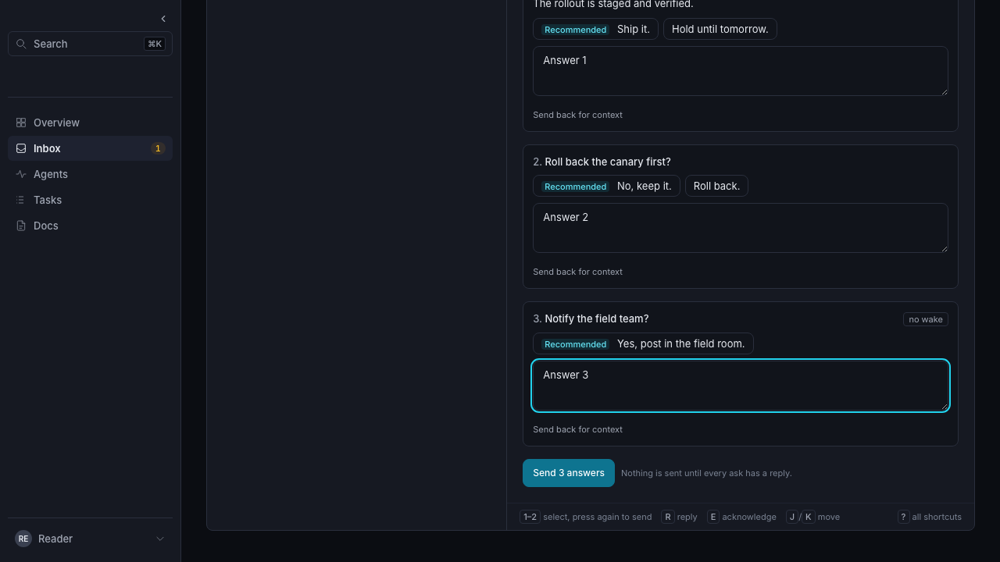

# Durable user work

The invariant is **never lose user input**. Core remains the source of truth for
confirmed data. Drafts and unconfirmed requests are private device-side work,
not a second workspace database. See the hard rule in root `AGENTS.md`.

## Rollout and acceptance

Stage 1 (SCA-781, PR #390) is merged. Stage 2 is tracked by SCA-786 and
ships in separate reviewable PRs grouped by surface. Topic metadata and event
single/bulk lifecycle recovery are migrated; the remaining audit below is still
open. These migrations do not claim whole-UI acceptance.

SCA-781 permits reviewable stages. The existing changes cover the human-attention
response path, the production timeout trigger, shared discussion composers, Inbox PM answers, Ask PM chat attachment uploads, task creation and document authoring. It does not claim that every UI
mutation already satisfies the invariant.

| Stage                     | Coverage                                                                                                              | Acceptance gate                                                                                                                                                 |
| ------------------------- | --------------------------------------------------------------------------------------------------------------------- | --------------------------------------------------------------------------------------------------------------------------------------------------------------- |
| Inbox response foundation | Freeform responses, suggested picks, acknowledgement/access/review outcomes, and context notes in both Inbox surfaces | IndexedDB/journal recovery, persisted requests, original-key retries, attention UX, cross-tab lock, privacy cleanup, timeout/524/offline/reload/duplicate tests |
| Discussion foundation     | Shared thread, topic, card and document replies/comments, including reply targets and selected-quote anchors          | Atomic message-event replay, durable composer context, shared scope lock, exact-key recovery and attention UX                                                   |
| PM foundation             | Inbox PM decision responses and Ask PM chat                                                                           | Reusable mutation outbox adapters; atomic replay audit for event creation, document/card comments and PM decisions; same recovery tests per adapter             |
| Attachment foundation     | Inbox and discussion file selections, upload bytes and completed refs                                                 | Atomic upload replay, original-byte/key recovery, storage denial, downloadable failures and privacy fences                                                      |
| Task/document authoring   | New tasks; new documents, document descriptions, revisions and inline titles                                          | Atomic nested mutation/replay, frozen original concurrency tokens, reload/offline/attention recovery and explicit rebase                                        |
| Remaining authoring       | Remaining card/plan/settings/lifecycle mutations and all other forms                                                  | Explicit draft target keys, replay-safe server endpoints, every mutation in the outbox, complete surface inventory guard                                        |

Decide replaced both Inbox surfaces. `DecisionCard` keeps the Inbox response
foundation unchanged: proposal taps and replies go through
`inboxResponseQueue.js` (persisted before the undo window, original key on
retry), the reply draft keeps the `inbox:<item-id>:reply` key on the list, the
permalink and the initiative page, and a PM decision answer goes through
`enqueuePmDecisionAnswer`, which refuses to send when it cannot persist.
Watch's by-stage moves use `enqueueTaskMove`. `tests/e2e/decide.spec.js` covers
one-tap answers, undo and drafts across the list and the permalink.

The full invariant remains incomplete. Do not enable blind retries
for an unaudited endpoint: an HTTP timeout can occur after the mutation committed.

## Current implementation

### Receipt retention and recovery age

Policy: receipt retention: 30 days; automatic recovery: 25 days.
The single numeric source is `core/internal/replaypolicy/policy.json`, embedded
by core and imported by the UI. The policy regression checks this documentation
against that source. Clients must never recycle a key for a different intent.
Exact retries do not refresh a receipt's creation time. After the retention
window the server may no longer recognize a previously used key; duplicate-post
protection for an old key is no longer guaranteed.

Core collects expired `idempotency_replays` rows in indexed batches bounded by
`gcBatchSize`, outside request writers. It checks once a minute and yields a
second between full batches until the backlog clears. Shutdown cancels and joins
the worker. No canonical event, turn, document, artifact or Inbox history is
deleted by this maintenance. The existing creation-time index is also installed
when PM initializes its standalone schema.

Both outboxes stop automatic **and same-key manual** sends at the recovery age,
including on reload/offline recovery and inside the send lock. Unknown ages fail
closed, including legacy Inbox records without an immutable creation timestamp;
their Undo deadline may have changed during a previous manual retry. The request stays in Needs attention with Copy/Edit and an
explicit **Retry as new** action that warns it may already have been sent.
That action checkpoints fresh keys before superseding the old request; original
content, concurrency bases and confirmed partial/conversation checkpoints remain.
It does not silently refresh a stale resource version. Clients outside this UI
must enforce the same cutoff before retrying an uncertain old request.

Identical requests submitted concurrently by two tabs are compared against
persisted scope state under the shared Web Lock. Only transport keys are ignored
for that comparison; authored JSON, targets, tokens and actor scope remain part
of the intent. A competing active request is adopted, and a confirmation made
after this submission began can satisfy it without another wire send. Different
bodies remain separate intents. A small fingerprint on confirmation tombstones
closes the race where the first request confirms before the second takes the
lock. This scans O(device scope records), like existing recovery enumeration;
there is no server-side history scan. Inbox confirmation clears only an exactly
equal saved value, retaining newer whitespace-only edits too.

`localWorkStore.js` stores records in IndexedDB, with indexes on scope and
principal. The scope is the existing organization/workspace/agent/actor tuple.
A separate synchronous localStorage entry for each record checkpoints each input
event before yielding; it closes the tab-close gap and is the fallback when
IndexedDB is denied. IndexedDB still works when localStorage hits quota. If both
fail, the UI warns and does not send; text stays in memory across same-tab navigation with a copy path.
An unavailable device store cannot honestly promise recovery after closing a tab.
If no checkpoint has succeeded yet, closing or reloading prompts the reader to
keep the tab open. JSON snapshots make reactive state cloneable in IndexedDB, and
submitted request bodies are frozen so later edits cannot change a retry.

`durableDraft` restores a field by explicit resource/field key and dispatches
input so Svelte state follows the restored value. It ignores stale reads after
typing, identity changes or unmount. Both Inbox surfaces share
`inbox:<item-id>:reply` and `inbox:<item-id>:context` keys. Suggested picks are
checkpointed before their visual confirmation.

The Inbox queue records the entire request, item, restore data, original UUID,
undo deadline, attempt count and retry deadline before sending. After reload it
rebuilds the current principal's work and resumes due requests. Network errors,
408, 429 and 5xx retry with exponential backoff capped at one minute. Attention
states retain text and never auto-retry. Focus and reconnect resume draining.
Successful server confirmation tombstones the request; a matching submitted
draft is cleared without clearing newer text written during sending. Explicit
Undo transfers the request back to a draft. Editing retains the older request
as recovery history and a newly submitted correction uses a new key.

Web Locks serialize sends across tabs for one scope when available. On non-secure
origins without Web Locks (such as plain-HTTP LAN or Tailnet hosts), an in-tab
promise mutex plus a best-effort localStorage/BroadcastChannel lease serializes
sends instead of failing. BroadcastChannel and storage events synchronize saved
changes and privacy revocation.
The next adapters must use the same scope-wide lock; do not create independently
draining per-surface queues.

Logout and principal switches clear the principal's records across workspaces,
erase visible drafts in other tabs, and fence late saves with an identity epoch.
Temporary session loss pauses and hides private work; it does not delete it.
The same owner can sign in and recover the original request/key, while another
validated owner replaces the previous owner and clears that owner's copies.
Device work is never sent to a hosted control plane. The old detail-page draft
timer used a workspace/item key without a principal; that timer and automatic
restore are removed. Existing legacy keys are retained until sign-out or a principal switch, when
unattributed drafts are cleared for shared-device privacy. They are never
automatically exposed to a new principal. A future legacy recovery path must obtain
explicit ownership rather than silently assigning those drafts to the next user.

User-facing failures are classified in `mutationStatus.js`. Raw upstream bodies
appear only as bounded plain text inside a closed technical-details disclosure.
The global unsent indicator includes attention states, and each failed item
offers the saved response, copy, edit and retry.
Pending responses remain open with a Pending badge until confirmed. The detail
page keeps the delivery state visible after submission; the reader can navigate
back to the Inbox and answer a different item while the first sends. The same
item's composer is held while an uncertain response is pending or retrying.

## Discussion composers

`durableForm` checkpoints JSON composer snapshots, including reply targets,
automatic mention prefixes, document anchors and already-uploaded artifact refs.
Native input/change events checkpoint synchronously; auxiliary state changes
also checkpoint through the action update. Draft targets combine the backing
thread and subject, shared across the drawer and inspection page. Restore reads
cannot overwrite newer typing or another target. Privacy cleanup suppresses
state-reset writes until a fresh edit, so clearing an owner cannot resurrect it.
Inbox notification choices and uploaded attachment refs use the same action.

`mutationOutbox.js` provides an adapter for message events. It freezes the
original event and request key before sending, retains pending/retrying/attention
records, and resumes after reload, focus or reconnect. The same scope-wide Web
Lock serializes it with Inbox sends. Both appear in the global unsent count.
Definitive errors offer the original text, copy, edit and manual retry. Editing
first checkpoints the complete composer and retains the superseded original
request as local recovery history. Confirmation refreshes the relevant timeline;
a refresh error does not turn a confirmed post back into a failed send.

## Attachment uploads

File selections in discussion and Inbox composers enter the shared mutation
outbox before any network upload. File bytes, name, MIME, destination refs and
original key are private JSON records in the existing IndexedDB/journal store.
Bytes use base64, trading storage overhead for the same safe fallback as other
work. IndexedDB handles selections that exceed localStorage quota; if neither
store can checkpoint the file, sending stops and the saved file can be downloaded
in the open tab. Closing during asynchronous file reading warns until a local
checkpoint succeeds. Unavailable storage cannot promise recovery after tab close.

Uploads share the scope lock and global unsent count with responses and posts.
Pending uploads hold their own composer's send button while other targets remain
usable. Successful uploads release local bytes only after acknowledgement and
persist an artifact receipt linked to the original composer. The receipt restores
the attached ref even if the component unmounted before success. Posting consumes
the receipt after confirmation; the frozen post/response retains its original refs.
An attention-state upload offers exact-key retry, saving the original file, and
choosing a replacement. Replaced requests remain in local recovery history.

Privacy revocations clear receipts as well as requests and drafts. Observing an
epoch does not count as applying its visible purge; both storage and channel
notifications apply each revocation once and fence late work.

## PM composers and answers

Ask PM and the Inbox decision note use explicit `durableForm` targets. Notes,
choice and conversation context restore under the submitting principal. The
legacy unattributed PM session draft is no longer automatically restored and is
removed on privacy cleanup. Normal navigation no longer discards a note or asks
readers to abandon work that was already checkpointed.

The chat adapter freezes separate creation and message keys, original actor,
context refs and text before sending. It checkpoints the created conversation ID
before sending its first message. A timeout or reload resumes the same step; an
attention-state edit retains that conversation ID and uses a fresh message key.
Conversation creation can be replayed after PM disconnect so accepted work can
still be confirmed. Confirmation preserves newer composer text and refreshes
history without converting a refresh failure into an uncertain mutation.

The decision adapter freezes the answer revision, choice, note and original actor.
Its original server response is saved before native auto-apply. Each delivery and
read-back stage journals its own original key and frozen revision before sending,
then checkpoints its receipt. Recovery skips confirmed stages and retries an
uncertain stage with its exact original body. Source-owned approvals retain
separate delivery controls. Confirmed answers enter the scoped Inbox cache even
when the originating component has unmounted. Epoch fencing still discards writes
after sign-out or principal replacement.

## Task and document authoring

Task creation checkpoints the complete outcome/context/criteria/owner/next-action/
due-date/board form. Document creation, descriptions, revision bodies and inline
titles have separate principal/resource targets. Revision and description drafts
retain their original base revision or update timestamp across reload; automatic
retry never substitutes a newer concurrency token. A definitive conflict keeps
the original draft and request. The explicit Use latest version action transfers
the original into an editable draft and refreshes its base without replacing the
authored text. Corrections submit a fresh key; older requests remain recovery
history. Confirmation closes/navigates only unchanged work and preserves newer
text. Closing an authoring form leaves its draft available when reopened.

`ExecuteWithReplay` uses a scoped write transaction for each audited keyed
operation. Nested primitive transactions become savepoints on that same database;
reads, ownership checks, quota checks, blob ledgers, default-board creation and
projections stay inside it. A nested rollback removes only its own partial work;
the outer rollback removes the whole mutation when saving the receipt fails.
Quota locking is acquired before the outer write lock and reused by nested
writers. Receipt lookup and insertion use the existing actor/scope/key index.
There is no new table or migration and no retry of unaudited operations.

## Plan and card surface audit

The current task detail and `PlanView.svelte` display plans; they contain no plan
editor or card content editor. Plan authoring currently runs through the core/CLI
`plan.set` command. Do not claim a UI plan composer migration or add a new editor
as part of this durability work. The UI guard rejects future direct `setCardPlan`
sends until a durable adapter and complete composer snapshot are introduced.

`PUT /cards/{id}/plan` now accepts an optional `request_key`. The replay hash binds
the canonical card, original plan, actor and original `if_updated_at`. Its nested
`SetCardPlan` savepoint writes the graph, card and board timestamps, work version
and event. It does not call a quota-locking writer. Enrichment and its authorization admission borrow the outer
write snapshot; the original complete HTTP projection is stored before commit.
The audit found that `PinReads` opened a second connection for admission even
inside the wrapper. It now uses a borrowed read snapshot, ensuring admission sees
uncommitted ownership changes and that closing a projection cannot close its
parent write transaction.
The custom CLI helper currently sends unkeyed requests and rereads the token when
none is supplied; callers needing recovery must retain the complete keyed HTTP
request rather than recomposing it from the latest read.
The single-connection test sets its pool limit after fixture creation: existing
unkeyed task creation reads quota usage while holding its native transaction,
which stalls on a one-connection pool. The keyed task path uses the bound outer
transaction; unkeyed quota reads remain a separate audit gap.
Tests cover eight concurrent requests with quotas enabled and a one-connection
pool, changed plans/tokens/targets, a later superseding edit, full rollback on
receipt failure, and replay denied after private ownership is revoked.

The original send now returns the stored JSON representation too: typed nested
responses previously changed field order on replay. Decoding uses `json.Number`
to retain integer precision. This applies to all routes using the general atomic
wrapper; plain unkeyed writes retain their existing behavior.

Command-palette assignment now checkpoints the selected person, task identity,
original timestamp and other assignees as a complete durable snapshot. The
`cards.patch` adapter freezes its original body and actor-bound key in the shared
outbox. Task and palette status stay inline; editing from the task reopens the
saved selection. The palette says the assignment is saved until confirmation; attention
retains copy/edit/retry actions. Editing restores the selected person and original
base. Only “Use latest version” updates the base and a subsequent send gets a new
key. Navigation, principal changes and late refreshes are fenced. The metadata parser
now respects the selected first assignee instead of sorting the list and possibly
retaining the previous owner; a regression test covers this ordering.

Keyed `PATCH /cards/{id}` commits card/board metadata, the lifecycle event, the
assignment wake artifact and queue row, and the original receipt together.
Authentication target lookup uses the existing bounded indexed notification
lookup before the primitive transaction; authorization of canonical resource
refs still applies to every nested write. `AppendEvent` and `CreateArtifact` skip
reacquiring the quota mutex only when this same Store already owns it through
`ExecuteWithReplay`. Quota usage, blob ledger, promotion and wake-row writes were
audited with quota-enabled single-connection tests. Content-addressed promotion
can leave an unreferenced blob after rollback, as with existing uploads; no
artifact, ledger ownership or wake survives a failed receipt. Projection
maintenance is notified only after commit. Unkeyed handlers retain best-effort
wake behavior. Tests inject failures at event, wake artifact, wake queue and
receipt storage, and prove full rollback, eight concurrent exact replays, changed
body rejection and denied replay after resource ownership is revoked.

Task moves now use `taskMoveWork.js` and the shared mutation outbox. Board drops,
keyboard and palette moves checkpoint complete intents; completion evidence drafts
restore across navigation/reload. Native requests freeze the observed board token,
task version, destination and ordering anchor. Source requests freeze the original
actor, revision, immutable intent key and separate original-receipt replay key.
`taskBoardMove.js` now contains only pure proposal/badge helpers; its direct sender
has been removed.
Keyed `POST /cards/{id}/move` now atomically commits board placement/rank, native
work version, completion resolution/evidence, dirty projections, lifecycle events
and the original receipt. The handler binds the canonical card/parent board,
original body, placement anchors and both optimistic tokens. It takes the event's
before-state under the same write lock, and notifies projection maintenance only
after commit. `MoveBoardCard` has no quota mutex; its scoped savepoint and response
reads borrow the wrapper's transaction. The already-audited `AppendEvent` shares
the wrapper's quota lock. Optional `if_version` fences work annotations that leave
the board timestamp unchanged. Concurrent retries, original receipts after later
completion, changed destination/anchor/token/evidence/target rejection, rollback
at both lifecycle events and receipt storage, and revoked ownership are covered
with real SQLite, quotas and a one-connection pool. Existing unkeyed moves keep
their best-effort event behavior.

PM phase proposals now support opt-in original receipts with `replay_key`, alongside
existing immutable-intent `request_key` deduplication. The new mode commits the
proposal, superseding writes, newly-created origin delivery and original HTTP
status/body together. Exact retries reauthorize the human, work and evidence and
validate an explicit origin binding before returning the stored receipt. Already
committed receipts recover after PM disconnection; new proposals still require
onboarding. Optional `actor_id` binds recovery to the original submitting actor.
Legacy callers omit `replay_key` and continue receiving the current decision,
status 200 and `replayed`/terminal-state metadata. First-time adoption of an
existing legacy intent freezes that call's 200 reuse result; it does not rewrite
the canonical decision or requeue historical origin deliveries.

The public mode uses a scoped PM write transaction and existing proposal
savepoints; it adds no primitive writes or quota lock. Authentication, work,
delivery-path and evidence projections are preflight reads. The receipt builder
is pure under the writer, and the durable origin binding is checked again there.
Preflight anticipates legacy deduplication; a different canonical identity/source
winning under the lock fails closed with conflict, preserving the input. The
no-policy `DB.ExecContext` fast path now honors a bound write transaction across
store wrappers, so standalone PM delivery writes cannot escape rollback or stall
one-connection pools. Real-core and single-connection tests verify eight concurrent
retries, receipt/delivery/decision-write rollback including superseding, frozen
projection/status after later work changes or answers, restart/disconnect
recovery, revoked resource/principal/origin access, and unchanged legacy/setup
behavior. Leased PM-turn proposals retain their existing path; this mode is for
human decision creation.

Move/evidence attention states retain copy/edit/retry actions. Editing transfers
the saved snapshot into its original composer; only “Use latest version” refreshes
the task/board bases, preserving destination, anchor and evidence. Missing bases
fail closed with the draft visible. One uncertain send per task prevents duplicate
intent keys, including board/palette submissions. Both paths preserve PM setup
guards and explicit source-move approval; recovery does not prompt again.
Confirmation refreshes canonical task/decision display without rewriting the
original request or receipt. Newer evidence in another tab survives confirmation.
An unfinished evidence draft must be sent or explicitly discarded before another
task or destination can replace it. Submitted snapshots remain in the outbox
while the composer can move on to other tasks.
Board undo submits a new intent using explicitly refreshed current bases;
pending moves never claim to have moved the task.

Card content revisions now have optional `request_key` original-result replay.
The handler binds the original decoded body (including legacy flat fields), actor,
canonical card and original base token. A keyed send requires a nonempty base;
unkeyed callers retain their response/validation contract. The revision entrypoint
also binds its own scoped writer for legacy calls, eliminating one-connection
quota-read waits and rolling back failed promotion. Current card visibility is checked
before exposing a receipt, and the original response survives later edits or quota
changes. New revisions, artifacts, ownership refs, card/board heads, dirty
projections, blob ledger writes and original receipts share the scoped writer.
The revision writer recognizes the outer quota lock; first-use ledger rebuilds
also join the transaction through canonical maintenance context and savepoints.
Blob promotion completes before the keyed outer receipt commits; promotion failure
cleans staging and rolls back canonical state. A later receipt failure can leave
an unreferenced content-addressed object, consistent with the existing staging
limitation. Projection maintenance is notified after commit.

Real-core SQLite tests with quotas and one connection cover eight simultaneous
retries producing one revision, identical original receipts after later edits,
changed bodies/tokens/targets, stale bases with fresh keys, rollback at revision,
head, board, ledger, promotion and receipt writes, initialization rollback, legacy
unkeyed writes, quota changes and denied replay after ownership revocation.
There is no current UI card content editor; the guard rejects future direct card
revision sends. The move browser suite additionally covers network timeouts,
journal fallback, total storage failure preventing sends, and authenticated
principal replacement clearing other tabs and fencing late failures.

## Event lifecycle recovery

Timeline and Messages archive/unarchive/trash actions share a principal-scoped
thread draft containing every selected event, action, reason and original
`archived_at`/`trashed_at` pair. Board timelines use a board target. The draft and
complete per-item requests are saved before sending. Reload, tab changes, offline
closure and lost acknowledgement retain the original actor, key and base.
Definitive failures retain copy/edit controls; editing creates fresh keys only
for unfinished items. Explicit “Use latest version” changes only their lifecycle
bases. Confirmation clears only the exact submitted draft. Principal replacement
removes private work and fences late completion.

The four existing event lifecycle routes accept optional `request_key` and
`if_lifecycle` fields. Keyed requests require both original lifecycle fields,
including nulls. Current access is checked before original-receipt replay, and the complete
receipt is authorized before returning any previously affected descendant IDs.
CAS, parent/reply visibility changes and the receipt commit in one scoped SQLite
writer transaction. Legacy unkeyed calls preserve their envelopes and error
codes. Event payloads, refs and timestamps remain append-only.

A keyed receipt optionally includes `affected_event_ids`, containing only scoped
rows actually changed in that transaction. Selected ancestors send first; their
receipts cover selected replies without stale extra requests. The outbox freezes
one shared `selected_bases` map alongside the per-item requests and sends it
unchanged with each ancestor. Inside the same writer transaction, every scoped
selected member of that cascade must still match its captured lifecycle pair,
including members the action would otherwise skip. A mismatch conflicts the
whole cascade and receipt. Legacy single-event request hashes remain compatible;
older saved bulk requests without this map require explicit copy/edit recovery
before sending. The shared map avoids duplicating snapshots in device storage.
Every partial
receipt is persisted before the next item. Confirmed items are skipped after
reload; editing unfinished work retains the earlier confirmation history.

Cascade discovery uses one recursive query capped at 2,000 descendants and
cycles deduplicated by `UNION`. Each expansion reads at most 2,002 indexed raw
candidate edges (at most 2,001 inbound raw reference edges per expanded event)
and fails closed on saturated raw fanout, including inaccessible
or non-message sources. Only candidate IDs bypass relation shadow filtering;
scoped event rows authorize every candidate before recursion or output. No
plaintext or inaccessible IDs enter the response. This prevents filtering hidden
edges from defeating the cap. Raw target lookups pin the existing `idx_ref_edges_target`
index before filtering edge kinds; event candidates use their primary key. At most 2,002 expansions each
inspect 2,002 edges, independent of workspace size. Selected-row reads and writes
use bounded primary-key sets, with no per-reply SQL calls.

`event_lifecycle_replay_test.go` covers all four actions, child/receipt rollback,
quota-enabled single-connection concurrent replay, changed bodies/targets/actors,
stale or incomplete bases, original results after later actions and revoked
access. `event_lifecycle_cost_test.go` checks the actual scoped SQL plan and VM
budget against the 4,096-row scale corpus, cycles and 3,000/33,000 inaccessible
cross-thread edges. `durable-event-lifecycle.spec.js` covers frozen retry,
partial bulk recovery, covered replies, explicit conflict rebase, edited reasons,
offline closure, storage denial and cross-tab principal fences. The AST guard
rejects new direct event lifecycle sends in Svelte.

The consuming cascade query is bounded after epoch admission; its private-fanout
fixture uses 78,403 VM steps and zero full scans at both sizes. The standard
4,096-row corpus measures 18 read calls, 12 returned rows and 3,979 VM steps for
the primitive action. These are distinct from inherited cold/stale authorization
closure admission and canonical business-write validation, whose cost can grow
with denied resources. The existing mutation exclusions in
`core/internal/server/testdata/performance_write_routes.json` still apply; this
slice does not claim that the entire HTTP mutation has workspace-independent
cost.

Review screenshots: [retrying](images/durable-event-retrying.png),
[partial bulk confirmation](images/durable-event-bulk-partial.png), and
[conflict](images/durable-event-conflict.png).

## Document lifecycle recovery

Archive, unarchive, trash and restore now accept an optional `request_key` and
`if_updated_at`. Keyed requests require the original metadata base and bind the
original actor, canonical document, action and complete decoded body to the
original HTTP status/body. Recovery checks current document visibility before
exposing the receipt; the receipt itself remains scoped. Later metadata or
lifecycle changes cannot replace a confirmed receipt.

The common lifecycle writer owns the quota lock, establishes the SQLite writer
before reading the base, and lends its scoped transaction to nested lifecycle,
event, ownership and projection writes. Token-aware unkeyed calls use the same
base check under the writer; legacy entrypoints also use it without storing a
receipt. Trash/restore event storage is quota checked inside the transaction.
There are no staged blob writes or physical blob deletions in these four paths.
Actual lifecycle changes advance `updated_at`/`updated_by`; idempotent legacy
archive/trash no-ops preserve them. Archive conflicts now return 409.

Real-core tests with quotas and one connection cover all four actions, eight
concurrent retries, original results after later lifecycle/metadata edits,
changed reasons/bases/targets, invalid keys/actors, missing and stale bases,
unkeyed stale-base rejection, no-op timestamps, rollback on document/event/dirty
projection/receipt writes, cold quota-ledger initialization/rollback, quota rejection/recovery and revoked ownership.
Knowledge metadata (`source`, `summary`, `tags`, `hosts`, `verified_at`) already
uses atomic document PATCH; new tests cover complete original metadata,
concurrent replay, receipt failure, explicit clearing, changed-body rejection and
revoked access. The current UI has no separate knowledge editor.

Detail archive/unarchive/trash/restore and list single/bulk lifecycle actions now
use complete durable snapshots and the shared outbox. A bulk selection is one
local checkpoint before its first send, with separate original keys, actors,
actions and metadata bases per document. Confirmed receipts are checkpointed
between documents; recovery skips confirmed items and retries uncertain sends
with their exact original bodies. Partial failures expose confirmed counts.
Editing keeps newer reason text and transfers only unfinished documents; the
original batch and receipts remain in recovery history. Only “Use latest version”
refreshes saved bases. Confirmation retains newer edits in another tab. Failed
local saving prevents sends and keeps the complete visible draft with copy and
explicit discard actions. Existing archive/trash confirmation guards remain.

The browser suite covers 524 and network timeouts, duplicate recovery across tabs,
offline tab closure, partial confirmation/reload, conflict editing and explicit
base refresh, newer reason preservation, total storage denial and cross-tab
principal replacement with late-send fencing. Existing lifecycle layout checks
cover four viewports. The AST guard rejects new direct document lifecycle calls
in Svelte surfaces and requires both routes to mount the durable composer.

Unused generic bulk/trash adapters have been removed after confirming they have
no callers. There is no workspace-trash route. Permanent purge remains a server
replay audit: physical blob deletion occurs after the database commit and needs
an authorization/tombstone recovery design. Legacy knowledge PUT also remains an
API audit; it has no current authoring form.

## Topic metadata recovery

The About editor checkpoints the complete title, summary and canonical topic
base under `topic:<id>:metadata`. Opening the editor loads `GET /topics/{id}`;
the backing thread projection's timestamp is never used as the topic base.
Initialization waits for device hydration; opening/closing clicks cannot replace
an unread authored draft.
Drafts restore on navigation/reload, including an explicitly empty summary.
Closing the editor keeps its saved work; **Discard draft** is the explicit
removal action. Storage denial is visible and prevents unpersisted sends.

`topics.patch` joins the scope-wide mutation outbox. It freezes the original
actor, canonical id, complete patch, concurrency token and UUID before sending.
Timeouts, offline closure and lost acknowledgements recover through the already
audited atomic PATCH receipt. Confirmation clears only the exact submitted
draft and refreshes display separately; newer edits survive. Version conflicts
stay in Needs attention with Copy/Edit/Retry. **Use latest version** fetches the
canonical topic before retiring the failed request, keeps current authored text,
and explicitly replaces its concurrency token while retaining the original
content comparison base; resubmission uses a new key. Untouched fields stay
omitted, preserving concurrent changes. Metadata saves omit provenance so
existing sources and notes survive. Failed reads
keep the original request recoverable. Identity epochs fence late topic loads
and the shared store/outbox enforce principal privacy and the 25-day cutoff.

`durable-topic.spec.js` covers canonical topic/thread timestamp separation,
complete draft navigation/reload/discard, offline tab closure, 524/network lost
confirmation and cross-tab exact-key replay, retained conflicts and explicit
rebase and failed-read recovery, newer empty-summary preservation, delayed device
hydration, cross-tab principal replacement/late sends and total storage denial.
The AST guard now forbids direct topic PATCH in all Svelte surfaces and requires a durable
snapshot on the About editor; its old callsite exception is removed. Core's
`TestTopicPatchAtomicOriginalReceiptAndAuthority` remains the replay prerequisite,
covering concurrency, quota/receipt rollback, changed-body rejection and revoked
authority.

No HTTP route or API shape changes. The additional read is one canonical topic
lookup by primary key, O(1) in workspace size, with existing scoped authorization;
no new list/stream queries or server polling. Device recovery remains O(records
in the current device scope) through the existing scope index.

## Notification settings

`/o/<org>/w/<workspace>/notifications` edits the caller's per-workspace channels
(`GET`/`PUT /notification-settings`, human principals only). The complete
channel form is a device draft under `notifications:settings` in the existing
organization/workspace/principal scope; it restores on reload and is reconciled
with the latest available channels. Save freezes the body (only rows with an
address) and a UUID into the `notifications.settings.set` outbox adapter before
any send. The `PUT` replaces the whole list and carries no request key, so a
timeout or lost acknowledgement is recovered by replaying the identical frozen
body, which is idempotent. Failures show the closed technical-details
disclosure only; Copy/Edit/Retry come from `MutationSendStatus`. Confirmation
adopts the response and keeps newer typing. Raw upstream bodies are never page
copy.

## Remaining live UI mutation audit

The following are actual direct SDK calls found in current browser code. Each
remaining callsite is now explicitly allowlisted in
`durable-mutation-allowlist.json`, including raw transport entrypoints, helper
modules and statically named computed calls. The test rejects added calls and
stale exceptions. This finite AST inventory does not prove arbitrary JavaScript
dataflow or whole-UI durability. Authentication and private credential controls
need protocol-specific review before persistence, not blind generic retries.

| Surface                         | Remaining direct mutations                                                                                         |
| ------------------------------- | ------------------------------------------------------------------------------------------------------------------ |
| Root actor creation             | `createActor` in the shell; preserve the complete creation form                                                    |
| Watch dashboard chooser         | `setWorkspaceDashboard`; preserve the selected document                                                            |
| Access and agent details        | Host patches/revocation, enrollment token creation/revocation, human invites/revocation and principal revocation   |
| Access administrator grants     | Grant/revoke mutations in `AuthAdminGrants`                                                                        |
| Setup prompt and workspace tour | Enrollment token issuance/revocation; audit their cleanup and authentication boundaries                            |
| Secrets                         | Creation/deletion; preserve complete owner-scoped authored work and audit original receipt/private result handling |
| Task refresh                    | `requestWorkRefresh`; preserve the requested target and original intent                                            |
| PM setup and lifecycle          | Audit the setup wizard and remaining retry/cancel/control adapters, beyond direct SDK-call matching                |

## Inbox control recovery

Inbox activity mark-read, stale task archive, and explicit PM delivery,
read-back and acknowledgement use `InboxControlWork` and the shared mutation
outbox. Clicking captures the complete intent before waiting for device restore.
The principal/workspace journal is written before sending. Storage failure keeps
the intent visible and blocks the network. Retries preserve each member's key,
actor binding and base, and confirmed members of a bulk request are checkpointed
individually. Editing and renewing an expired partial batch never resends its
confirmed members. An explicit “Use latest version” refreshes only unfinished
members' bases; it never refreshes a retry automatically.

The current UI has no mark-unread, snooze/unsnooze, watch/unwatch, separate
dismiss or server-saved filter sender to migrate. Mailbox and task filters are
URL state; Watching is a computed classification. Acknowledging/dismissing an
Inbox response already uses `inboxResponseQueue`; full-page response drafts
include notify mode, target and attachment refs, and the complete submitted
response is frozen with its idempotency key. These choices keep their existing
adapter and the respond write path is unchanged here.

`POST /home/read` opts into atomic replay with `request_key` and a frozen cursor
for every group (at most 100). The cursor event must be currently visible and
belong to the currently visible group. A newer arrival remains unread; the
monotone read-cursor UPSERT cannot regress another tab's newer cursor. Keyed
receipts return only `{ ok: true }`, avoiding a projection refresh inside the
writer. Legacy unkeyed calls retain their existing response/count behavior.

`POST /cards/{id}/archive` opts into atomic original receipts with `request_key`,
`if_version`, `if_lifecycle` and `if_latest_observation_id`. The lifecycle tuple
protects visibility changes. Archive and restore also advance the monotonic work
version, so an archive/restore round trip conflicts with a never-committed archive. An empty
observation ID explicitly fences “no successful observation yet”, so a first
successful refresh also conflicts. Archive and its receipt commit together;
receipt failure rolls back the archive. Legacy unkeyed behavior is retained.

PM dispatch, reconcile and acknowledge accept optional `request_key` and
`if_revision`; dispatch also captures `if_action_revision`. The first action
CAS and original admission receipt commit together, with both the action and
approval pair checked inside the writer. Dispatch admits `sending` before its
source call. Its stored receipt confirms that admission, not delivery, and
later source results cannot alter the original receipt. Recovery never repeats
an admitted source handoff or read-back. A crash between admission and handoff
leaves a sending action for read-back/explicit human handling; automatic recovery
must not invent a new external send. Approval auto-apply uses the same keyed control protocol with separate frozen
delivery and read-back bases. Every replay rechecks current
scope, owner and permission before returning a receipt.

The bounded read proof uses event/group ID and partial handle indexes, and the
five-column `idx_ref_edges_access_cover` for point membership. Raw group/edge
candidates cannot return data without the scoped event and scoped group checks
in that same admitted resource read snapshot. No workspace home lookup or stored
JSON scan is added. The synthetic actual-SQL regression checks both plans and
VM work at 0 and 4,096 background records, including an edge-only group match.
This consuming-query bound excludes existing cold/stale canonical authorization
closure admission and ordinary business-write authorization; those remain the
shared policy's costs, not a claim that all Inbox requests are bounded already.

## Stage 2 handoff

SCA-786 owns the remaining rollout. This section is the follow-up pointer for
every remaining exception in `durable-mutation-allowlist.json`. Keep surface
groups in separate reviewable PRs; do not expand the merged Stage 1 PR.

- Topic title/summary editor: migrated in the first SCA-786 surface PR; see
  [Topic metadata recovery](#topic-metadata-recovery). Topic creation and
  lifecycle are separate server prerequisites below.
- Event single/bulk lifecycle: migrated through the shared event outbox; see
  [Event lifecycle recovery](#event-lifecycle-recovery).
- Inbox controls: migrated through frozen keyed control requests; see
  [Inbox control recovery](#inbox-control-recovery).
- Task refresh, dashboard selection and dev actor creation: audit receipts and
  migrate full intents before automatic retry.
- Access/host/enrollment/invite/admin/principal controls, Secrets, setup/tour
  choices, workspace activation and login/session controls: design authorization,
  private-result and credential handling before choosing device persistence.
- Remaining card/document/plan edit forms: creation, document text/title,
  assignment, task moves/evidence and document lifecycle are already migrated.
  No current card content or plan editor exists; new editors must use the store
  and outbox. The server revision/plan prerequisites do not constitute UI coverage.
- Topic creation/lifecycle, legacy knowledge PUT, permanent purge and remaining
  unaudited server replay: audit nested writes, quota locking, current authority,
  original receipts, tombstones and physical blob deletion. Purge cannot safely
  inherit generic retry semantics without its deletion/recovery protocol.
- Replace finite exceptions with whole-UI enforcement, including dynamically
  aliased senders, raw transport, authored controls and protocol-specific auth
  exclusions. Existing exceptions are not permission for new bypasses.

Review boundary: the invariant tests enforce migrated Inbox/discussion/PM,
uploads, task/document authoring, assignments, moves, document lifecycle, topic
metadata and event lifecycle.
The separate exact callsite inventory makes all remaining known SDK/transport
exceptions visible. Neither test claims complete semantic analysis or complete
delivery of the issue's original acceptance criteria.

## PM chat HTTP recovery prerequisite

Known owner/workspace-bound conversation and message keys can now pass the HTTP
onboarding gate after disconnect and restart. The normal service still validates
the original body and current permissions; new writes retain their setup gate,
including the legacy response for an invalid fresh body. Recovery returns the
same conversation/turn and creates no additional dispatch. Legacy message replay
continues to return the canonical turn, whose lifecycle status can advance.

Conversation access now checks every pinned context ref as well as primary work
before exposing message replay, history or a human turn read. SQLite handler
tests cover disconnect/restart, duplicate recovery, changed bodies, fresh-write
refusals and pinned-reference revocation. A real scoped core test confirms that
resource ownership revocation denies recovery/readback with a one-connection
pool; scoped rows may become invisible before the recovery peek, retaining the
setup refusal without exposing private existence.

**Conversation original receipts are now an opt-in server prerequisite.**
`POST /pm/conversations` accepts a separate `replay_key`, binding the actor,
workspace and complete decoded creation body before reference normalization.
Thread metadata/handle creation, the conversation and the original 201 body
commit in one scoped writer. Thread creation has no quota mutex or blob writes;
its nested transaction is a savepoint. Authentication and pinned-reference
checks run before the writer. Replay rechecks scoped canonical visibility and
returns the frozen body after later metadata changes or PM disconnect/restart.
Legacy conversation/thread collisions without this receipt fail closed; custom
services without an audited transactional thread callback cannot opt in.
Eight concurrent retries and injected thread/conversation/receipt failures are
tested against real SQLite with one connection. Revoked ownership and pinned
access deny replay. Existing unkeyed callers and persisted UI creation bodies
retain legacy behavior. Newly queued UI requests now opt in to this mode.

**Message original receipts are now an opt-in server prerequisite too.**
`POST /pm/conversations/{id}/messages` accepts `replay_key`, binding the actor,
workspace, canonical conversation and complete decoded message body. The turn,
send state, trigger event, wake artifact/ownership refs, blob ledger, queue row
and original public 202 response commit together when the bridge is enabled.
Without the bridge, the durable turn and receipt commit together.
Raw runtime/auth readiness runs before the writer and leaves no turn on failure.
The shared primitive replay wrapper owns the quota lock; event/artifact writers
reuse it, while turn admission, cold-ledger rebuild and queue writes use scoped
savepoints. Canonical intent is invisible to runners until commit. Promotion can
leave an unreferenced content-addressed blob after a later failure; canonical
artifact/ledger/event/wake/turn state rolls back. This existing limitation remains.

Eight concurrent retries return byte-identical receipts and create one turn,
event, artifact and wake. Tests inject failures at turn/send-state/event/artifact/
ledger/queue/receipt writes, promotion, quota and readiness, then retry the exact
request. Turn/event/artifact/queue collisions without an original receipt fail
closed. Recovery after later turn progress or disconnect/restart returns the
original public response without future lease credentials. Current scoped turn
and conversation visibility and pinned authorization remain mandatory. Legacy
callers retain advancing canonical turn replay and existing dispatch behavior;
custom callbacks without an audited writer/preflight/persistence split fail closed.
Newly queued Ask PM requests now use separate creation/message request and
receipt keys. Recovery passes the complete saved bodies verbatim; it never
upgrades legacy pending bodies. The creation receipt is checkpointed separately,
so editing a rejected first message reuses its confirmed conversation while
creating fresh message keys. Rejected creation edits use fresh creation keys too.
An explicit retry of an already failed turn creates a new intent; uncertain
delivery retries retain their existing saved keys. Confirmation refreshes current
conversation/turn state rather than displaying the frozen receipt as live status.

The shared Edit action now restores the composer before waiting on draft
persistence; otherwise a late restore could replace text typed during the
transfer. The original request is superseded only after durable transfer succeeds.
Browser checks cover timeout/524, offline/tab closure, reload/duplicate recovery,
legacy bodies before/after the conversation checkpoint, conflict/editing, current
state refresh, newer drafts, total storage denial and cross-tab principal changes
with late creation success/message failure. The guard enforces exact saved-body
sends and rejects statically named computed direct SDK calls in migrated surfaces.
Remaining live forms, general replay gaps and whole-UI enforcement stay open.

## Topic patch server prerequisite

`PATCH /topics/{id}` now accepts an optional actor-bound `request_key`. Keyed
requests require the original `if_updated_at`; canonical target, complete decoded
body and original timestamp representation are bound before markdown/timestamp
normalization. Topic metadata, backing-thread fields, reference edges, dirty
projections, update event and original HTTP result commit together. Current
resource visibility is checked before recovering a receipt. Eight concurrent
retries, changed body/base/target rejection, quota changes, later edits, write
failures, cold-ledger rollback and revoked ownership are tested with one connection.

Keyed and legacy topic patches now read/merge/check their base under a scoped
writer. Quota locking precedes it and is shared with the replay wrapper. Update
events participate in quota accounting; cold ledger initialization joins rollback.
Topic patch and lifecycle writes merge managed backing-thread JSON fields instead
of replacing the entire body, preserving ownership metadata and other extensions.
Partial topic provenance patches retain omitted notes/extensions; explicit empty
notes still clear them.
Regression tests cover patch/archive/unarchive/trash/restore. Topic metadata and
patch decoding preserve large integer values, including through later edits and
changed-body rejection; other endpoint decoders retain their existing behavior.

**The live topic title/summary editor is migrated.** Its complete durable
snapshot and outbox retain conflicts instead of closing the unsaved form.
Canonical `getTopic` supplies the initial topic version; the backing thread
projection's timestamp is not used. The explicit latest-version action refreshes
only the concurrency token, retaining the original content comparison base so
untouched fields remain omitted from the patch. Title/summary saves omit
provenance, preserving its existing source list and notes. Owners/resource refs
remain display-only. See [Topic metadata recovery](#topic-metadata-recovery).
Topic lifecycle original receipts, legacy knowledge PUT, purge and remaining live
forms stay open.
The existing `POST /topics` helper records replay after creation and can adopt a
legacy ID collision without a receipt; it needs a separate atomic replay audit
before a topic-creation outbox is added. No current Svelte caller was found.

## Replay audit

No HTTP routes or database migrations are added. PM request contracts now accept
an optional original `actor_id`, which must match the authenticated actor; decision
answers and multipart attachment uploads also accept an optional `request_key`. Generated clients and CLI registries
are regenerated from the canonical OpenAPI contract.

| Path                                                          | Current evidence                                                                                                                                                                                                                                      | Next action                                                                                                                                           |
| ------------------------------------------------------------- | ----------------------------------------------------------------------------------------------------------------------------------------------------------------------------------------------------------------------------------------------------- | ----------------------------------------------------------------------------------------------------------------------------------------------------- |
| `POST /inbox/{id}/respond`                                    | Existing `idempotency_key` contract; `AppendHumanAttentionResponse` atomically commits response and replay; concurrent eight-request test proves one event and rejects changed-body key reuse                                                         | Preserve full original request/key through device recovery; covered here                                                                              |
| `POST /events` (`message_posted`, including comments)         | `AppendEventWithReplay` atomically writes the event and actor/key/body-bound replay; concurrent retries and injected replay-insert failure prove one event or full rollback                                                                           | Covered by the discussion adapter; legacy ID collisions without replay fail closed instead of adopting an existing event                              |
| Document/card comments                                        | Same shared `message_posted` write; document comments are projected from backing-thread events                                                                                                                                                        | Covered by MessagesTab, including selected-text metadata; single/bulk event lifecycle also migrated                                                   |
| `POST /pm/decisions/{id}/answer`                              | Actor/key/body-bound original HTTP result commits atomically with the revision-checked decision and optional action; concurrent retries, changed-body conflict, injected receipt-write failure and revoked authorization tests                        | Covered by the PM answer adapter; unkeyed clients retain legacy revision replay                                                                       |
| PM conversation creation and messages                         | Opt-in replay_key atomically commits new thread/conversation/original 201 receipt, or turn/event/artifact/ledger/wake/original public 202 receipt; concurrency, rollback, legacy-collision and revoked-access tests. Legacy replay remains compatible | Composite chat adapter and original receipt opt-in covered for new requests; old pending bodies retain legacy recovery                                |
| `POST /artifacts/attachments`                                 | Actor/key-bound hash includes metadata, original filename, chosen MIME and content hash/size; artifact, ownership refs, blob ledger and replay receipt commit together. Concurrent retry, rollback and revoked-ownership tests                        | Covered by the attachment adapter; content-addressed staging precedes the transaction and retries revalidate permissions                              |
| `POST /work`                                                  | New task, optional default board, backing threads/card and original response commit with replay. Quota-enabled concurrent/rollback and revoked-ownership tests pass                                                                                   | Task creation covered; existing card edits and lifecycle remain rollout work                                                                          |
| `POST /docs`, `PATCH /docs/{id}`, `POST /docs/{id}/revisions` | Document/revision/metadata writes and original response commit with replay; exact body/base-token retries and changed-key conflicts                                                                                                                   | Creation, description, text revision and inline title adapters covered; legacy PUT and other lifecycle/knowledge forms remain gaps                    |
| `PUT /cards/{id}/plan`                                        | Graph, timestamps, work version, event and original response commit together; concurrent quota-enabled/single-connection replay, original projection, rollback and revocation tests                                                                   | Keyed core API covered; CLI helpers currently send unkeyed requests, and the UI has no plan editor. Future composers still need durable drafts/outbox |
| `PATCH /cards/{id}`                                           | Card metadata, event, assignment wake packet/queue and original receipt commit together; quota-enabled single-connection concurrency, rollback at four writes, changed-body and revoked-access tests                                                  | Command-palette assignment covered; card lifecycle remains open; revision replay covered below                                                        |
| `POST /cards/{id}/move`                                       | Placement, completion evidence, work/board tokens, lifecycle events and original keyed receipt commit together; quota-enabled single-connection concurrent replay, original receipt, injected rollback and revoked ownership tests                    | Core keyed replay and board/palette/completion draft/outbox recovery covered                                                                          |
| `POST /pm/decisions`                                          | Optional replay_key atomically commits human proposal/superseding/new origin delivery and original status/body; exact concurrent/restart/disconnect recovery and revoked access tests. Legacy request-key replay retains current-state semantics      | Core receipt mode and source-owned move actor/key/revision/destination/evidence recovery covered                                                      |
| `POST /cards/{id}/revisions`                                  | Original actor/body/base/canonical target bound to atomic revision/artifact/ownership/head/board/dirty/ledger/receipt commit; first-use ledger and promotion/receipt failures tested with quotas and one connection                                   | Core keyed replay covered; no current UI content editor, future direct sends guarded                                                                  |
| `POST /docs/{id}/{archive,unarchive,trash,restore}`           | Actor/action/body/base/canonical-target bound original receipt; scoped nested lifecycle/event/dirty writes, quota-enabled single-connection concurrent replay, rollback and revoked access tests                                                      | Current detail/list/bulk lifecycle UI covered; unused legacy adapters removed; purge remains an API audit                                             |
| `POST /events/{id}/{archive,unarchive,trash,restore}`         | Atomic original receipt and bounded scoped reply cascade; actor/action/target/body/lifecycle base bound; rollback, concurrent replay and revoked access checks                                                                                        | Timeline and Messages single/bulk actions covered; restore has a replay-safe adapter but no current UI entrypoint                                     |
| `PATCH /topics/{id}`                                          | Actor/canonical-target/body/base-bound atomic topic/thread/refs/event/original receipt; concurrent replay, quota/cold-ledger/write rollback, integer precision and revoked-ownership tests                                                            | Core replay and live topic metadata draft/outbox recovery covered; topic creation/lifecycle remain open                                               |
| Remaining card/settings/lifecycle forms                       | Diverse create/patch/action commands                                                                                                                                                                                                                  | Audit and migrate each remaining operation; extend whole-UI inventory                                                                                 |

## Checks and extension rules

`durableInputContract.test.js` parses the Svelte AST to require durable draft
actions on every authored Inbox response field, requires the shared discussion
composer action, PM answer/chat and assignment actions, and rejects direct Inbox/event/PM answer/chat/upload/task/document authoring sends
and assignment sends in any Svelte surface. This is a guard for the migrated scope; subsequent stages
must extend it to all mutation forms. Do not present it as whole-UI enforcement.
The guard rejects direct `moveBoardCard` and `createPmDecision` calls in Svelte,
requires durable board/palette move snapshots, and rejects reintroducing the
legacy direct helper. `durable-moves.spec.js` verifies exact original bases/key
after uncertain delivery, offline completion/tab closure, explicit conflict
rebasing, source proposal recovery and cross-tab preservation of newer evidence.

`durable-inbox.spec.js` covers reload/navigation/new-tab drafts, timeout and 524,
closing an offline tab, interrupted confirmation with a duplicate retry across
tabs, definitive conflicts, storage denial and delivery-state screenshots.
The browser mock checks exact body/key replay; the real core concurrency test
checks that duplicate retries produce one canonical response event.

Filed ask batches (`POST /asks/batch`, `inbox-batch.spec.js`) answer through
the same queue: one batch item renders one decision section per ask with the
section's own `inbox:<item-id>:reply:<ask-ref>` durable draft, the single
submit sends one `{answers: [...]}` body through `POST /inbox/{id}/respond`,
and Undo hands each section's text back to its own draft key. Core records
every member answer atomically and replays the whole batch through one
idempotency key.

`durable-discussion.spec.js` covers reply metadata restoration, timeout/524,
offline tab closure, lost confirmation with reload and duplicate replay, storage
failure, copy/edit states and state screenshots. The document layout spec also
checks that a selected quote survives reload and is posted with its instruction
at all four viewports.

`durable-pm.spec.js` covers draft reload/tab closure, offline submission, lost
creation/message confirmation, original-key replay across tabs, attention-state
editing without duplicate conversation creation, newer text preservation and
decision-answer recovery. Backend tests assert atomic decision/action/receipt
rollback, concurrent replay, exact HTTP snapshots and fresh authorization.

`durable-upload.spec.js` covers offline file selection/tab closure, lost upload
acknowledgement/reload/multiple tabs, byte/key preservation, downloadable definitive
failures, replacement and attachment refs in recovered Inbox/discussion posts.

`durable-authoring.spec.js` covers complete task drafts, exact-body creation
recovery, offline document creation/tab closure, description conflicts with
explicit rebase and revision body/base recovery. Existing document authoring
regressions cover creation, revisions and inline titles. Real-core tests exercise
eight concurrent exact creates, quota-enabled nested rollback, changed-body
conflicts, original concurrency-token replay and revoked ownership.

Message, PM answer, attachment and authoring replay perform indexed point lookups on the existing
`(scope, actor_id, request_key)` primary key and bounded event/replay inserts in
one transaction. Existing ownership triggers and scoped query wrappers remain
active. No new GET/stream path, schema or migration is added.

IndexedDB lists use the scope index, O(records in the device scope), and target
lookups use the primary record key, O(1). The fallback
journal scan is O(device records), with no workspace server scan. Existing Inbox
point/list requests and authorization paths are unchanged. Recovery does not add
server polling; it sends due persisted requests and uses normal refresh listeners
after confirmation.
